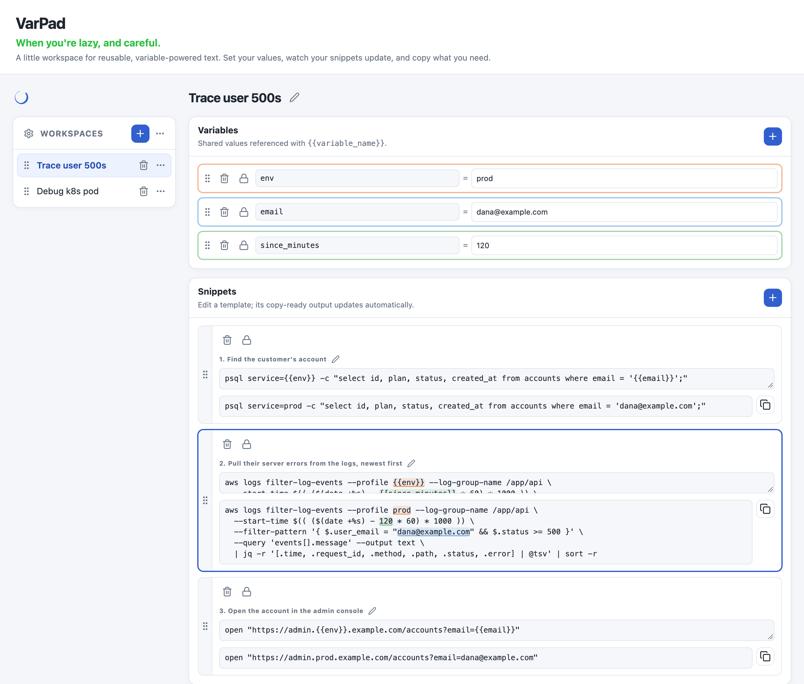
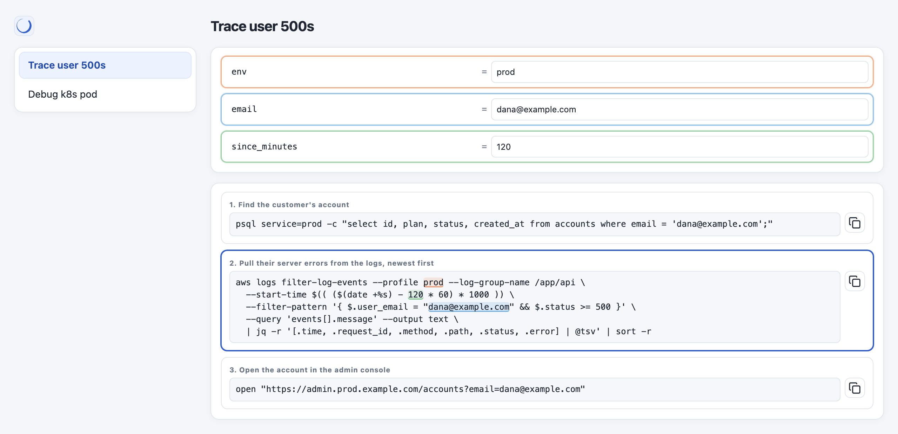
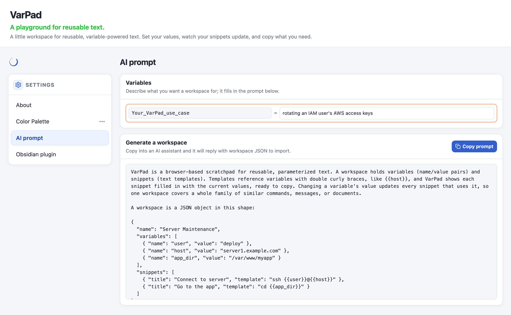

# VarPad

A notepad with variables for reusable text. Define values once, reference them with `{{variable_name}}`, and copy the filled-in snippets.

Change a variable's value and every snippet that uses it updates, so one workspace covers a whole family of similar commands, messages or documents.

## Features

- **Workspaces:** separate sets of variables and snippets, listed in the sidebar. Rename them, drag to reorder, and export or import them as JSON.
- **Live output:** each snippet shows its template next to the copy-ready result. Undefined variables are flagged.
- **Autocomplete:** type `{{` in a template to pick from the workspace's variables.
- **Variable highlighting:** click a snippet to colour-code its variables in the template, the output and the variable list.
- **Locks:** variable names and templates stay locked until you unlock them, so routine use only touches values.
- **Themes:** Day, Midnight and Forest, or build your own palette and share it as JSON.

## Zen mode

Click the ensō above the sidebar to strip VarPad down to the values you type and the output you copy. The header, edit controls and templates are hidden. VarPad remembers the mode between visits.

## Generate a workspace with AI

**Settings → AI prompt** has a ready-made prompt that explains VarPad's workspace format. Describe your use case, copy the prompt into an AI assistant, and import the JSON it replies with.

## Usage

VarPad is a single `index.html` file. Open it in a browser. Your workspaces are saved in that browser's local storage, so export them to back them up or move them to another browser.

## License

[MIT](LICENSE)
